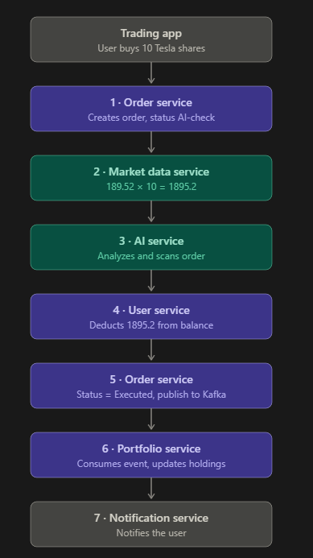

# You Buy Stock. What Happens Next?

## Order Flow

**Trigger:** User buys 10 shares of Tesla in the Trading App.

1. **Order Service** receives the request, creates the order, and sets status to `AI-check`.
2. **Market Data Service** gets the current stock price (189.52). Total = 189.52 × 10 = **1895.2**.
3. **AI Service** receives the order details and analyzes and scans the order.
4. **User Service** deducts **1895.2** from the user's balance.
5. **Order Service** sets `order.status = Executed` and publishes the event to Kafka.
6. **Portfolio Service** consumes the event and updates holdings.
7. **Notification Service** notifies the user.

## Flow Diagram

